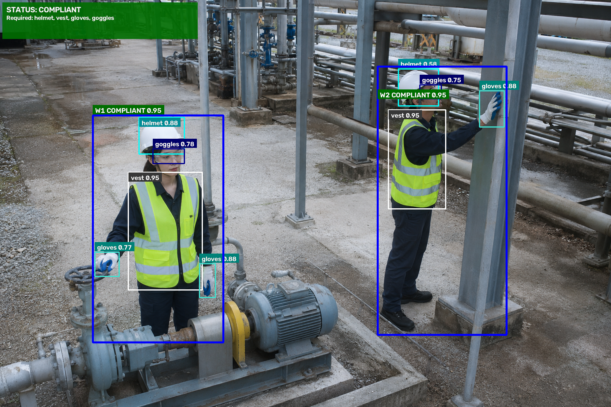
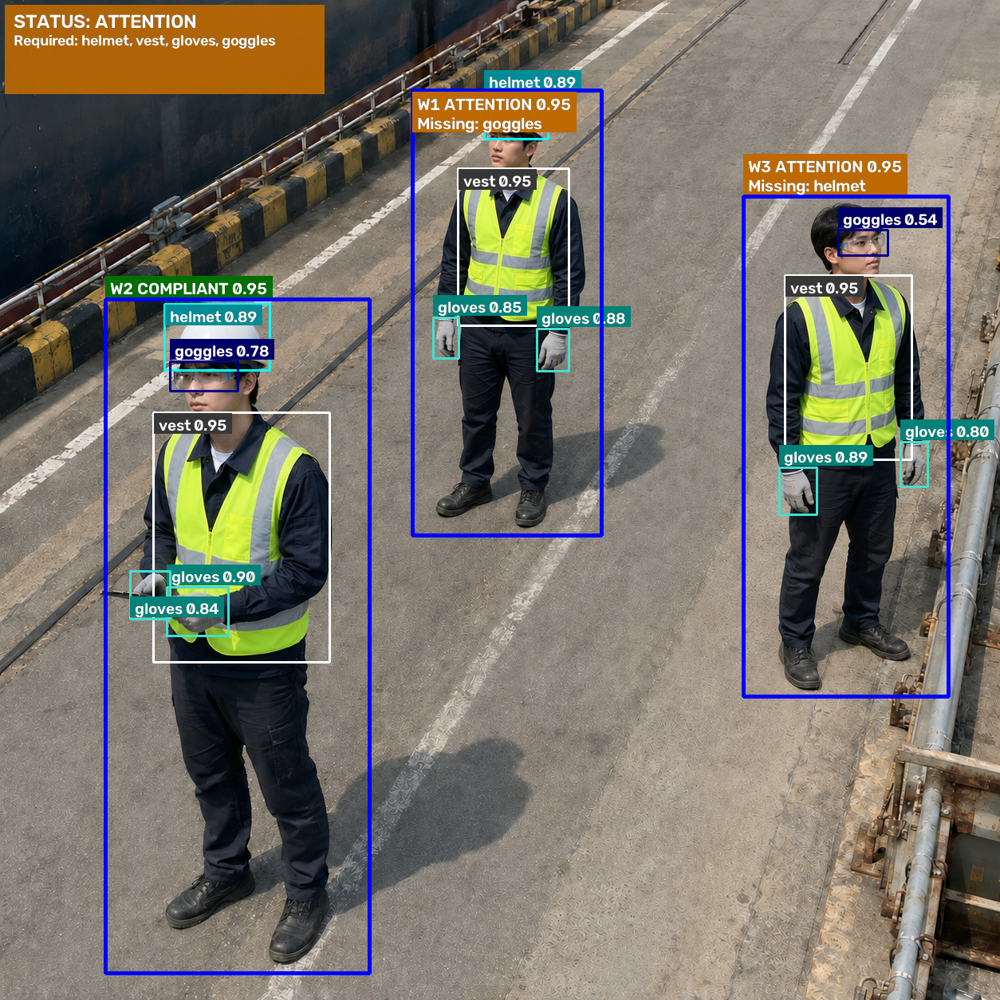
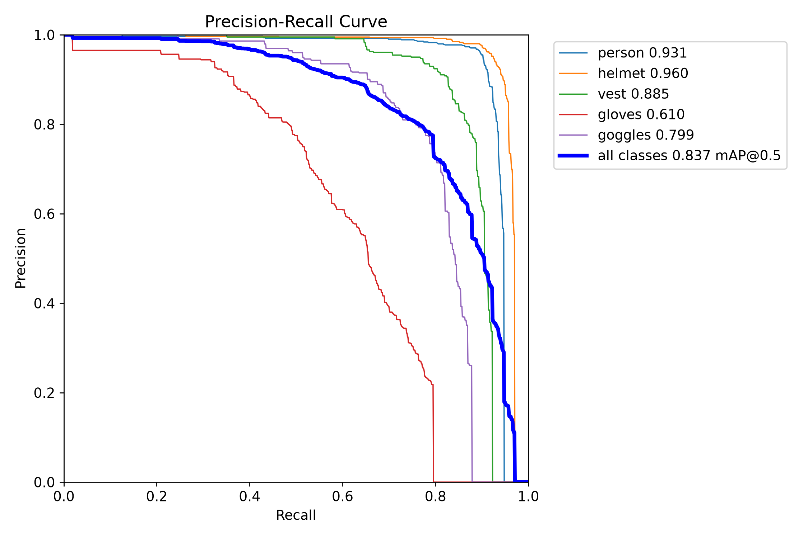
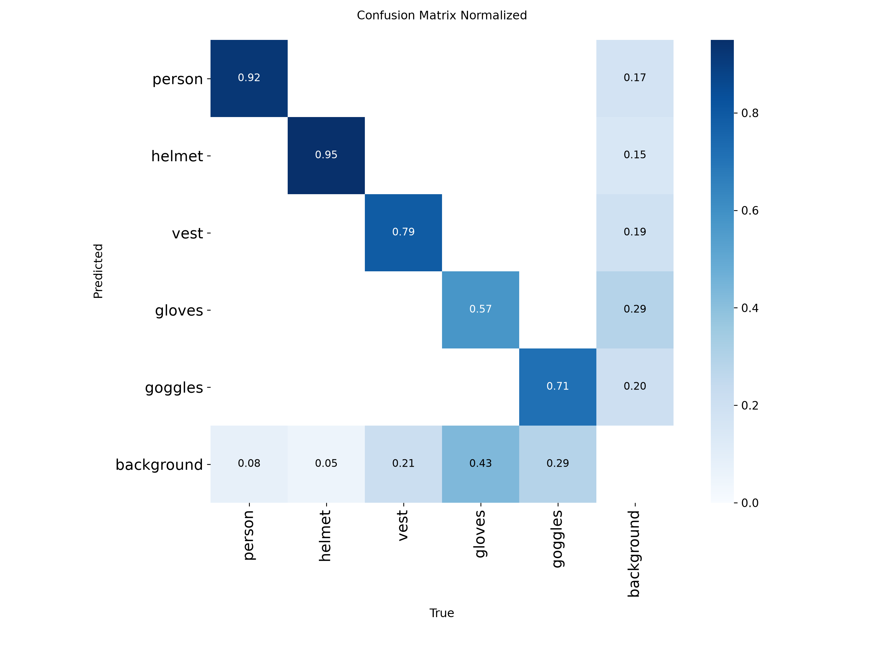

# Smart Factory Safety Inspector

Smart Factory Safety Inspector uses YOLO to detect workers and personal protective equipment (PPE), then checks each worker against a user-selected set of PPE requirements.

## Visual Demo

| All required PPE assigned | Required PPE missing from the detections |
| --- | --- |
|  |  |

## Key Results

- **Object detection (YOLO26s, held-out test)** — Precision **0.8846**, recall **0.7708**, mAP50 **0.8371**, and mAP50–95 **0.5833**. [Final model evaluation](notebooks/05_Final_Model_Evaluation.ipynb)
- **End-to-end compliance** — **94.38%** image-level accuracy on the application test. [Application results CSV](reports/application_evaluation.csv)

## What the System Does

The detector recognizes five classes: person, helmet, vest, gloves, and goggles. Users select which PPE types to require before running a check on an image or a folder of images. The system associates detections with individual workers and returns per-worker decisions, an overall image status, and an annotated image. [Multi-worker example](assets/demo/multi_worker_compliant.png)

| Status | Meaning |
| --- | --- |
| `COMPLIANT` | The worker has an assigned detection for every required PPE type. The image receives this status when every detected worker meets the requirement. |
| `ATTENTION` | A required PPE type is missing from the worker’s assigned detections. The image receives this status when any detected worker requires attention. |
| `UNKNOWN` | The image contains no detected person, so there is no worker-level decision. |

## Pipeline / Architecture

```text
Image → YOLO detections → Filter person and PPE detections
      → Associate PPE with individual workers → Apply required PPE rules
      → COMPLIANT / ATTENTION / UNKNOWN
```

## Model Evaluation

Six YOLO variants were compared on the validation split. YOLO26s was selected because its validation performance was close to YOLO26m’s with a smaller checkpoint and lower compute cost. The final detector was then evaluated on **323 held-out images containing 2,523 annotated objects**. [Model comparison](notebooks/04_Model_Comparison.ipynb) · [Held-out test details](notebooks/05_Final_Model_Evaluation.ipynb)

The evaluation notebook records the overall detector metrics. The CSV provides the per-class breakdown, where helmet and person have the highest mAP50–95 and gloves have the lowest. [Per-class results CSV](reports/evaluation_results.csv) · [YOLO26s training curves](assets/training/yolo26s_training_results.png)

| Precision–recall curve | Normalized confusion matrix |
| --- | --- |
|  |  |

## Application-Level Evaluation

This separate test scored the **final image-level compliance decision** across eight PPE requirement groups. The detector metrics above measure object detection on the held-out dataset.

| Expected status | Predicted `COMPLIANT` | Predicted `ATTENTION` | Total |
| --- | ---: | ---: | ---: |
| `COMPLIANT` | 71 | 9 | 80 |
| `ATTENTION` | 0 | 80 | 80 |
| **Total** | **71** | **89** | **160** |

The pipeline made **151 correct** and **9 incorrect** decisions. All nine errors were false `ATTENTION` results, with zero false `COMPLIANT` results. Recall was **88.75%** for `COMPLIANT` and **100%** for `ATTENTION`. [Application results CSV](reports/application_evaluation.csv)

## Dataset

The final dataset contains **3,865 images** and **23,686 annotations** across the five detector classes. Annotations were manually reviewed and corrected where needed. Synthetic images were used only for training, and the validation and test splits contain real images only. [Dataset curation report](docs/Dataset_Building_Report.md)

The dataset is kept outside the public repository. Check the licenses of external dataset and image sources before redistributing any of those materials.

## Repository Structure

```text
README.md
requirements.txt
.gitignore
config/             Dataset metadata and runtime settings
src/                Training, inference, compliance, and visualization
eda/                Exploratory data analysis
data_processing/    Dataset cleanup utilities
docs/               Technical documentation
notebooks/          Dataset, training, and evaluation reports
assets/             Demo images and plots
reports/            Machine-readable results
train.py
evaluate.py
check_safety.py
batch_check_safety.py
run_eda.py
```

## Installation

The tested setup uses Python 3.11.9 on Windows with PyTorch for CUDA 12.1. From the repository root in Windows Command Prompt, create and activate a virtual environment, then install the tested PyTorch build and the pinned requirements.

```bat
python -m venv .venv
.venv\Scripts\activate
python -m pip install torch==2.5.1+cu121 torchvision==0.20.1+cu121 --index-url https://download.pytorch.org/whl/cu121
python -m pip install -r requirements.txt
```

For CPU, Linux, macOS, or a different CUDA version, install an appropriate PyTorch build first. The dependency pins target the tested Windows/CUDA environment.

## Required External Artifacts

| Local path (NOT INCLUDED IN GIT) | Required for |
| --- | --- |
| `models/best.pt` | Single-image and batch safety checks, plus detector evaluation |
| `data/final_dataset/` | Training, detector evaluation, and EDA |

Git excludes the dataset, model weights, training runs, generated outputs, and virtual environment. The dataset and trained weights are currently unavailable through this repository.

## Usage

Run these commands from the repository root once the required local artifacts are in place.

| Command | What it does |
| --- | --- |
| `python check_safety.py` | Prompts for the required PPE and an image path, then saves an annotated prediction. |
| `python batch_check_safety.py` | Prompts for the required PPE and an input folder, then saves annotated images and a CSV report under `outputs/predictions/`. |
| `python evaluate.py` | Evaluates `models/best.pt` on the held-out test split. Requires `data/final_dataset/data.yaml`. |
| `python train.py` | Trains the six configured models using the local dataset and GPU device `0`. Existing training output directories may need to be renamed or removed before rerunning the configured experiment. |
| `python run_eda.py` | Regenerates EDA outputs and overwrites `notebooks/01_Final_Dataset_EDA.ipynb` with a newly generated report. |

## Limitations

- Gloves and goggles are harder to detect than larger PPE such as helmets and vests. Image quality, occlusion, worker pose, and PPE visibility affect performance.
- PPE assignment is rule-based. Overlapping workers can make ownership ambiguous, and missed detections can trigger false `ATTENTION` results.
- The default training and evaluation configuration assumes a CUDA GPU.
- This is a portfolio/research project and is not a certified industrial safety system.

## Documentation

- PPE filtering, worker association, and status rules. [Compliance logic](docs/compliance_logic.md)
- Dataset curation, model selection, and evaluation methodology. [Technical report](docs/technical_report.md)
- Dataset, training, and evaluation evidence. [Project notebooks](notebooks/)

## License / Usage Status

Repository licensing is under review. Ultralytics components and models have their own licensing terms, and external dataset and image licenses may impose separate restrictions. The repository currently offers no public distribution of the dataset or trained weights.\n